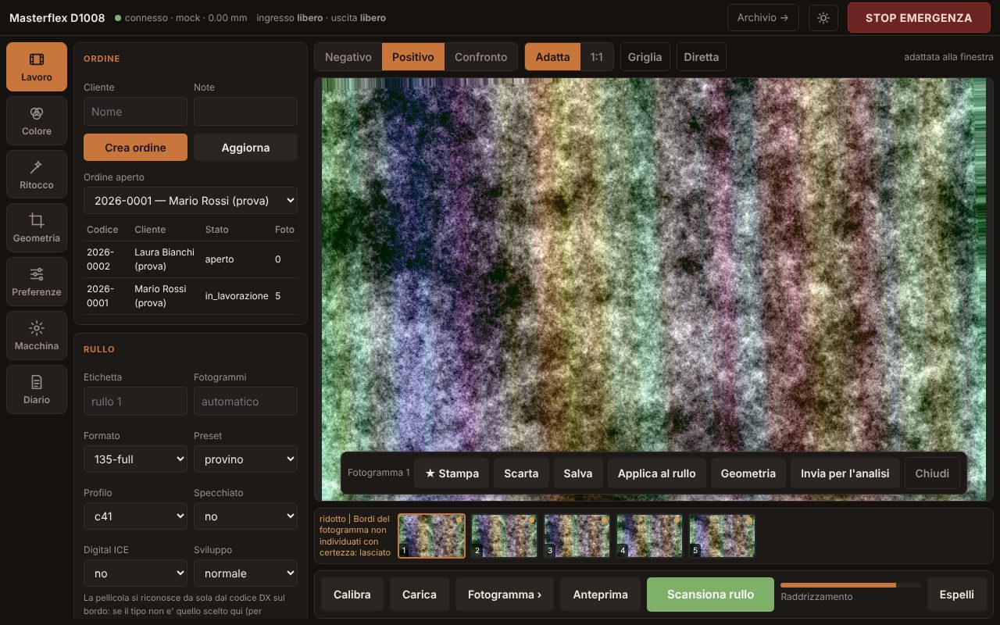
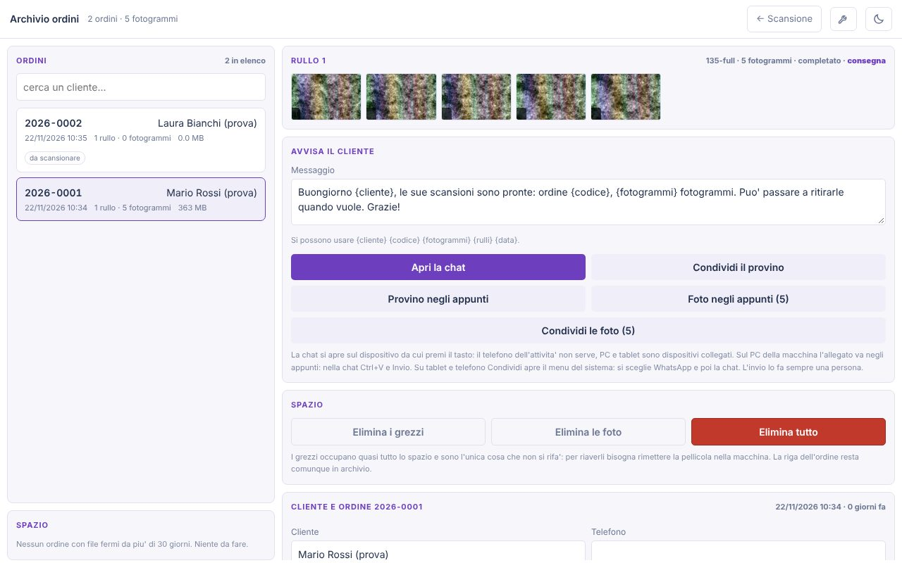
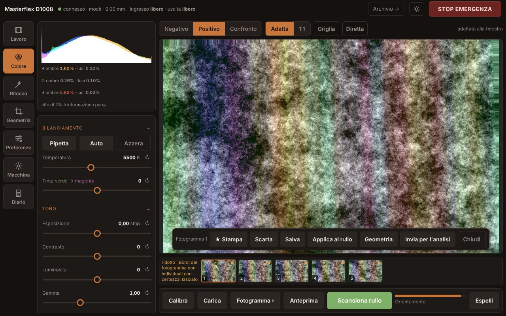
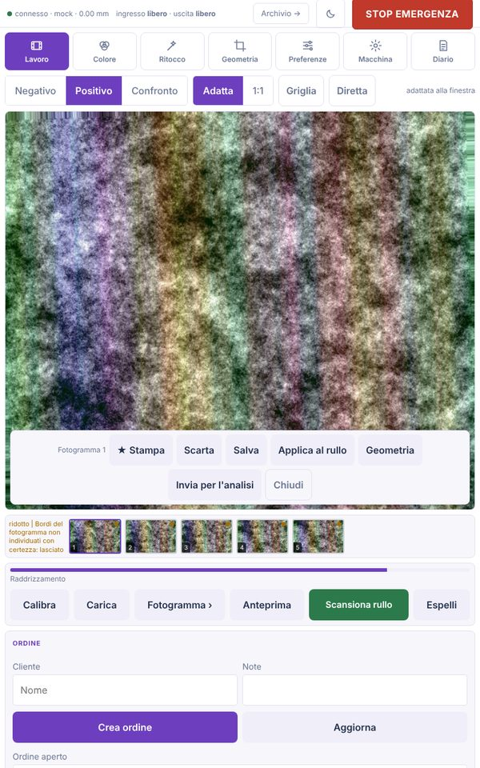

# Gretag Masterflex D1008 — scanner pellicola

Software nuovo per lo scanner pellicola di un minilab **Kodak/Gretag
Masterflex D1008**. Il programma originale (2001) legge 2100×1400 pixel e ne
salva 600×400. Questo progetto tiene della macchina quello che funziona, cioè
l'SDK e i firmware Kodak, e sostituisce il resto: si salva tutto quello che
il sensore vede, si gestiscono ordini e consegne, e si comanda tutto da un
tablet.



Il progetto ha due parti:

- **filmscan** ([`software/`](software/)): un agente comanda la macchina
  attraverso l'SDK Kodak `scn_dll.dll`; un'interfaccia web gestisce rulli,
  colore, ordini, archivio ed export.
- **EKframePnP** ([`driver/EKframePnP/`](driver/EKframePnP/)): un driver
  nuovo per la scheda di acquisizione IAQ (PCI, PLX 9080), perché su alcune
  macchine il driver Kodak del 2000 non parte più. Interfaccia identica
  all'originale: l'SDK lo usa senza accorgersene.

## Cosa fa

**Scansione**
- **Rulli interi a strisce**: il carrello porta avanti la striscia
  fotogramma per fotogramma, la espelle e aspetta la successiva. I
  fotogrammi vuoti o non esposti si riconoscono e si contano.
- **Calibrazione del giorno** obbligatoria: azzeramento dei motori,
  calibrazione della macchina, poi dark e flat.
- Esposizione automatica per canale, pressore automatico, autofocus del
  carrello, posizionamento a mano con il video della macchina.
- **Digital ICE** per rullo, con cinque motori a scelta: il nostro
  (*filmscan*), [openICE](https://github.com/marcinz606/openICE), la
  traduzione di [nkscan](https://github.com/activexray/nkscan), la libreria
  Kodak della macchina o una pulizia semplice.
- Grezzi sempre conservati: l'archivio si rielabora quando la resa migliora,
  senza rimettere la pellicola nella macchina.

**Colore**
- Inversione del negativo in spazio densità, **colore deciso sul rullo** e
  non sul singolo fotogramma, memoria per tipo di pellicola dal codice DX.
- Negativi sottoesposti, sovraesposti e velati riconosciuti e trattati a
  parte; luce al tungsteno corretta.
- Curve, ritocco, densità locale, profili bianco e nero con viraggi, una LUT
  (`.cube`, `.3dl`, `.lut`) in fondo alla catena.
- Negativo lineare in DNG o TIFF a 16 bit per chi lavora con Lightroom o
  Negative Lab Pro.

**Banco e consegna**
- Clienti, ordini e rulli; consegna per rullo o per ordine (JPEG, TIFF,
  negativi lineari, provino), avviso su WhatsApp, copia automatica su una
  cartella di rete, conservazione e pulizia.
- **Elaboratori in rete**: altri PC (anche un server Unraid in Docker)
  elaborano i fotogrammi mentre la macchina legge.

**La macchina**
- Avvio automatico all'accensione, con desktop di Windows ripristinato.
- **Collegamento remoto**: la macchina manda i suoi registri, senza i dati
  dei clienti, a un repository privato, e prende gli aggiornamenti dal ramo
  `main` di questo.
- **Fine rullo** (chiusura ordinata) e **STOP EMERGENZA** (ferma tutto e
  aspetta l'ok di un tecnico).

L'interfaccia va su monitor 4:3 e 16:9, tablet, telefono, in tema chiaro o
scuro.

| Archivio | Colore | Tablet |
|---|---|---|
|  |  |  |

Le schermate sono fatte con lo scanner simulato: le immagini sono sintetiche
e i clienti inventati.

## Stato

| Componente | Stato |
|---|---|
| [filmscan](software/) | in uso sulla macchina di riserva con la macchina vera |
| [Driver EKframePnP 2.1](driver/EKframePnP/) | funziona sulla riserva; manca la verifica di equivalenza col banco di prova completo |
| Carrello Capri (COM5) | firmware 1.15, richiesto ([decisione 0006](documentazione/decisioni/0006-firmware-carrello-1.15.md)) |
| Formati | 135 provato; APS e 110 non ancora provati con i motori veri |

Problemi aperti e prossimi passi: **[documentazione/stato.md](documentazione/stato.md)**.

## Cosa serve

- Un Masterflex D1008 con il suo PC: **Windows 7 a 32 bit** (i driver non
  sono firmati), CPU anche **senza AVX**.
- Il software originale Kodak/Gretag installato in `C:\MasterflexD`, da una
  copia legittima: serve almeno la cartella `Scanner` (SDK e firmware).
  Questo repository non lo contiene.
- Il driver della scheda: l'originale `EKframe.sys` dove funziona, altrimenti
  [EKframePnP](driver/EKframePnP/).
- Un browser recente sul tablet; sul PC della macchina Chrome 109 o Firefox
  ESR 115, gli ultimi per Windows 7.

## Installazione

L'installer è uno solo, per una macchina pulita e per l'aggiornamento:

1. su un PC con Linux (o WSL) e questo repository:
   `sh strumenti/aggiornamento/prepara.sh dist`, che crea
   `masterflex-installer-<data>.zip` con Python 3.8 e le librerie dentro;
2. sulla macchina: estrarre lo zip e fare doppio clic su `INSTALLA.bat`.

Da lì in poi si usa solo **`software\MASTERFLEX.bat`**:

```
 AVVIO          1  completo, macchina vera
                2  completo, motori fermi (per le prove)
                3  man in the middle: programma originale + osservatore
 COLLAUDI       4  collaudo dello scanner (senza e con pellicola, IR, DX, carrello)
                5  firmware del carrello
                6  collegamento remoto: registri e aggiornamenti
 MANUTENZIONE   7  installa / ripara       8  avvio automatico
                9  programma originale     10 disinstalla
```

Con il collegamento remoto configurato la macchina si aggiorna da sola a
ogni avvio. Tutto il resto, dalla prima accensione al lavoro di ogni giorno,
è nella **[guida per l'operatore](documentazione/filmscan/guida-windows.md)**.

### Provarlo senza la macchina

Su qualunque PC con Python 3.8 (le impronte di `requirements.txt` valgono
solo per le wheel di Windows a 32 bit: altrove si installano le stesse
versioni senza impronte):

```sh
cd software
pip install numpy==1.22.4 scipy==1.9.1 Pillow==10.4.0 tifffile==2023.7.10 openpyxl==3.1.5
python selftest.py                      # la catena di elaborazione
python run.py --web --driver mock       # l'interfaccia con lo scanner simulato
```

Poi aprire http://127.0.0.1:8080/. Dettagli in
[software/README.md](software/README.md).

## Struttura del repository

```
README.md               questo file
CHANGELOG.md            cosa cambia, per componente e versione
CONTRIBUTING.md         come si lavora: rami, commit, versioni, cosa non pubblicare
CLAUDE.md               contesto per le sessioni di lavoro con Claude

documentazione/         tutta la documentazione, con indice e regole
  stato.md              stato attuale e problemi aperti
  decisioni/            una scheda per ogni scelta importante
  filmscan/             guida per l'operatore, ponte, archivio
  hardware/             scheda IAQ, carrello Capri, dati della macchina
  software-originale/   SDK Kodak e programma originale
  immagini/             schermate dell'interfaccia

driver/EKframePnP/      pacchetto/ (collaudato) · sorgenti/ · verifica/

software/               filmscan
  MASTERFLEX.bat        l'unico file da lanciare sulla macchina (menu)
  filmscan/             interfaccia web, servizio, elaborazione
  ponte/                l'agente che parla all'SDK Kodak
  terzi/                componenti di terze parti, con le loro licenze

strumenti/aggiornamento/  prepara.sh (crea l'installer) · INSTALLA.bat
```

## Piattaforma

Windows 7 **a 32 bit**, Python 3.8 a 32 bit, CPU **senza AVX**. Il perché
sta in [decisioni/](documentazione/decisioni/):

- driver non firmati → solo Windows a 32 bit;
- SDK Kodak a 32 bit → Python a 32 bit;
- Python 3.8 è l'ultimo per Windows 7;
- niente AVX → numpy 1.22.4, scipy 1.9.1.

## Licenze

- Il codice di questo repository è sotto licenza [MIT](LICENSE).
- [`software/terzi/openice/`](software/terzi/openice/): openICE, GPL-3.0,
  con i sorgenti accanto ai binari. Gira come programma separato.
- [`software/terzi/nkscan/`](software/terzi/nkscan/): la licenza MIT di
  nkscan, di cui `filmscan/ice_aperto.py` è una traduzione.
- `software/certificati/cacert.pem`: i certificati radice di Mozilla
  (certifi), MPL 2.0.

## File proprietari e marchi

Il repository **non contiene** software Kodak/Gretag: niente driver
originale, SDK, firmware, pacchetto CapriFirmware, backup del Parameter
Flash, manuali o programmi di servizio. La documentazione li cita con
percorsi e indirizzi, per chi ne ha una copia legittima.

Il driver EKframePnP è stato ricostruito dal binario originale per
interoperabilità con l'hardware posseduto, ed è verificato in emulazione
contro l'originale.

Kodak, Gretag, Masterflex e Digital ICE sono marchi dei rispettivi
proprietari. Questo progetto è indipendente: non è affiliato né approvato da
loro.

## Avvertenze

La macchina ha motori che tirano pellicola. L'interfaccia web non ha
cifratura: va usata solo su una rete locale fidata, mai esposta su internet.
Il software è fornito così com'è, senza garanzie (vedi la licenza): provare
sempre prima con una pellicola di prova, mai con quella di un cliente.
